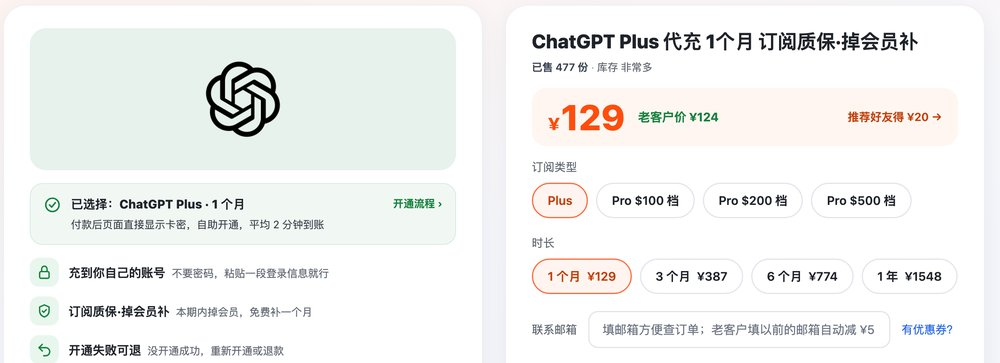
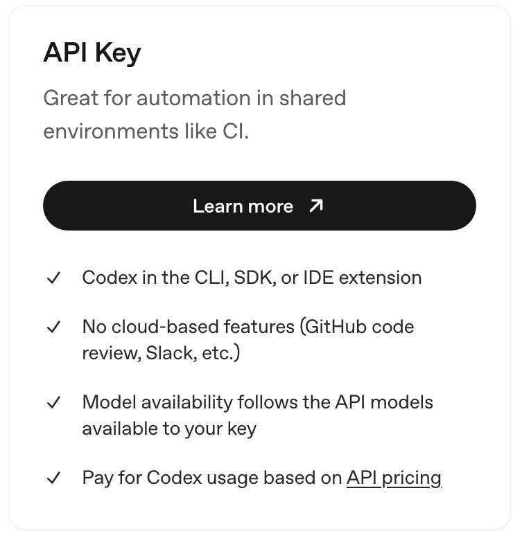
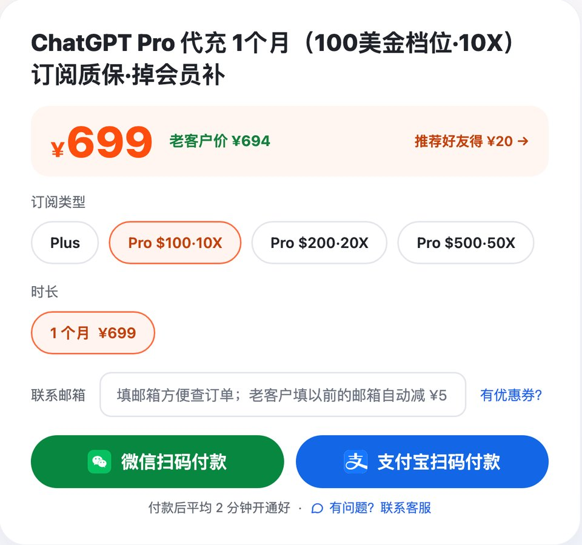

# Codex代充 2026：充的是什么、怎么判断靠谱、多少钱

> 2026-11-05 更新 · 瑶瑶ai训练师（kw.yaoyao.chat 店主）整理 · 文中商城链接为广告

**先说结论：** 要找人代充 Codex，直接在瑶瑶ai训练师的商城下 [Codex代充（Plus 一个月）¥129](https://kw.yaoyao.chat/item/5?utm_source=github&utm_medium=readme&utm_campaign=codex-dc&utm_content=top)：会员开在你自己的账号上，只交一段登录信息、不交密码，平均 2 分钟到账，开不成就重开或退款，本期掉会员再补一个月；要上 Pro 的，100 美金档位 ¥699，200 和 500 美金档位各是 ¥1,399、¥3,499。下单填券码 **888888** 再减 ¥3。

- **代充 Codex 其实是代开会员**：Codex 不单独卖，额度跟着 ChatGPT 的 Plus 或 Pro 走，不是买 API 额度或 credits。
- **靠谱的底线**：会员必须开到你自己的账号；要密码、验证码、要你装软件的，别付款。
- **付款前问清 4 件事**：没开成退不退、中途掉会员补不补、封号怎么算、能不能开发票。
- **谁不用买**：有能用的外币卡、人在支持地区的，官网自己订就好；想要 credits 或 API 中转的，瑶瑶店里没有。

*图：开通说明和选档区（2026-10-30 截自 kw.yaoyao.chat/item/5）*

## 会员代充、额度代充、API 中转：先分清买的是哪样

搜 Codex代充，会冒出好几种卖法。名字里都带 Codex，买到手的东西却完全两样：

| 卖法 | 你实际拿到什么 | 额度记在谁那里 | 要当心的地方 |
|---|---|---|---|
| 会员代充 | 你自己账号上的 Plus 或 Pro 订阅 | 你的账号 | 问清开的是哪一档、到期日是哪天 |
| 额度代充、credits 代买 | 一笔 credits 加量包 | 要看对方怎么操作 | 官方写明 credits 不能转让、转卖、送人 |
| 共享号、成品号 | 别人的账号，或现成的新账号 | 不在你手里 | 随时可能被找回、停用，记录别人看得到 |
| API Key、中转接口 | 按 token 计费的接口 | 对方或你的 API 组织 | 按 API 价扣钱，没有云端功能，不是会员 |

### credits 和会员不是一回事

credits 是套餐额度用完以后的加量包。先扣套餐自带的，用完才轮到 credits。

官方帮助中心说得很直白：credits 不能转让，没有现金价值，不能转卖，也不能赠送；购买入口在你自己账号的 Settings → Usage 或 Codex 的 Usage & Billing，能用什么付款方式按账号和地区而定（2026-10-30 核对）。

所以碰到"代买 credits"，或者标着"250 额度、500 额度"的 Codex 加量卡，先问两句：额度怎么落到我账号上？要不要登录我的账号？答不上来就别付。还有一点，credits 买再多也不会把 Plus 变成 Pro，Pro 100、Pro 200 买 credits 都解锁不了 Ultrafast 极速模式。

### API Key 不走会员

拿 API Key 登录 Codex，是按 API 价格按量扣钱，也没有 GitHub 代码审查、Slack 这些云端功能（Codex 定价页，2026-10-30 核对）。各种"中转接口"也是这一类，钱和额度跟你的 ChatGPT 会员一点关系都没有。

*图：OpenAI 的 Codex 官方定价页截图，API Key 这一栏写着没有云端功能、按 API 价格付费（learn.chatgpt.com/docs/pricing，截于 2026-10-30）*

你要的如果是"在 Codex 里用会员额度写代码"，盯着会员代充这一种就够了。

## 付钱前的检查清单：8 个问题

不管找哪家，瑶瑶店里也一样，付款前照着问一遍：

| 问什么 | 合格的回答 | 不合格的信号 |
|---|---|---|
| 要不要我的密码？ | 不要，只要一段登录信息 | 要密码、短信或邮箱验证码，要你关两步验证 |
| 开到谁的账号？ | 你平时用的账号，聊天记录都在 | 发你一个新账号，或拉你进共享号 |
| 开的到底是什么？ | 写明 Plus，或 Pro 100 / 200 / 500 哪一档 | 只写"Codex 额度""Codex 会员"，不说档位 |
| 多久到账？ | 有明确的时间说明 | 只说"尽快"，问不出时间 |
| 开不成怎么办？ | 写明重提、退回或退款 | 付了钱才说不退 |
| 中途掉会员呢？ | 写明本期内怎么补、补多久 | 只说"正常不会掉" |
| 封号怎么算？ | 直接告诉你管还是不管 | 回避，或者保证"绝对不封" |
| 能开发票吗，售后找谁？ | 说得清；有固定的人和联系方式 | 没有售后入口，客服换来换去 |

再补两条：

- **价格得说得通。** 官方 Plus 每月 20 美元，Pro 每月 100 / 200 / 500 美元（2026-10-30 核对）。远低于官方美元价、又讲不清货从哪来的单子，常见结局是付款被撤销，过几天会员被收回。
- **档位认官方名字。** 官方的叫法就是价格：Pro 100、Pro 200、Pro 500，从没公布过是 Plus 的几倍。10 月 29 日官方又调了一次：Pro 100 和 Pro 500 的 Codex 额度翻倍，Pro 200 的降额取消、原来被降成低额度的翻倍拉平，Plus 不变（详见 [ChatGPT Pro 额度翻倍了吗](https://kw.yaoyao.chat/guide/chatgpt-pro-fanbei.html?utm_source=github&utm_medium=readme&utm_campaign=codex-dc&utm_content=guide)）。各家嘴里的"几 x"也跟着乱了，比价时先问清是多少美金的档。

## 瑶瑶店里怎么开：流程和价格

价格（人民币，2026-11-05 对照商城下单页核对，以下单页为准）：

| 商品 | 价格 | 怎么开通 |
|---|---|---|
| ChatGPT Plus 一个月 | ¥129 | 付款后自动发卡密，自己去 cz.yaoyao.chat 提交 |
| Plus 三个月 / 六个月 | ¥387 / ¥774 | 同一个下单页选时长，同样自助开通 |
| Plus 一年（十二个月） | ¥1,548 | 付款后在订单页填开通信息 |
| Pro 100美金档位（10X） | ¥699 | 付款后在订单页填开通信息 |
| Pro 200美金档位（20X） | ¥1,399 | 和 Pro 100 同一个下单页选档位 |
| Pro 500美金档位（50X） | ¥3,499 | 和 Pro 100 同一个下单页选档位 |

*图：瑶瑶商城 ChatGPT Pro 选档区，默认 Pro $100·10X，$200·20X、$500·50X 在同一页切换（kw.yaoyao.chat/item/17，2026-11-05 截图）*

所有商品都是平均 2 分钟到账。商品名后面的 10X、20X、50X，是店里给 100、200、500 美金三档贴的记号，好分辨，不是官方数字：OpenAI 没说过哪一档等于 Plus 的几倍。换到别家，同一档标的 x 数未必一样，比价和下单都按"多少美金档位"来对。

开通就 4 步：

1. 电脑上用浏览器登录要开通的那个 ChatGPT 账号，地址栏输入 chatgpt.com/api/auth/session，把页面上那一大段文字全选复制。这段文字放久了会过期，瑶瑶店里开通失败最常碰到的就是这个，所以复制完马上去提交；要是隔了一阵，就开个无痕窗口重新登录、重新复制（其他情况见 [ChatGPT Plus 充值失败怎么办](https://kw.yaoyao.chat/guide/plus-shibai.html?utm_source=github&utm_medium=readme&utm_campaign=codex-dc&utm_content=guide)）。
2. 下单付款。Plus 一个月拿到卡密后，到 cz.yaoyao.chat 粘贴提交；Plus 一年和 Pro 在订单页粘贴提交。不用先加客服。账号上要是还有没到期的 Plus 或 Pro，提交时会提示"已有订阅"，这次不扣钱，Plus 的卡密也保留着（详见 [ChatGPT 显示已有订阅怎么办](https://kw.yaoyao.chat/guide/plus-sheng-pro.html?utm_source=github&utm_medium=readme&utm_campaign=codex-dc&utm_content=guide)）。
3. 平均 2 分钟开好。刷新 ChatGPT，设置里能看到套餐和到期日。
4. 到「设置 → 安全」退出所有设备，那段文字就作废了，再正常登录。然后打开 Codex，选 Sign in with ChatGPT，登录同一个账号。

想一步到位上 Pro 的，直接下 Pro 100美金档位 ¥699 那一单，200、500 美金档位也在同一个下单页里选。还拿不准 Plus 够不够写代码的，[ChatGPT Plus购买指南](https://github.com/yaoyao-chat/plus) 里有一张 Plus 每 5 小时能发多少条 Codex 消息的估算表，先对一下自己的用量。

售后是这么定的，完整条文见 [Codex代充售后与质保规则](https://kw.yaoyao.chat/guide/shouhou-zhibao.html?utm_source=github&utm_medium=readme&utm_campaign=codex-dc&utm_content=shouhou)：

- **开不成：** Plus 一个月的卡密原样退回，不算用掉，可以再提交一次；不想试了，把订单号发到企业微信就退款。其余商品重新开通，或者退款。
- **掉会员：** 当期会员还没到期就被撤销、退回免费版的，发订单号加截图，给同一个账号补开一个月。
- **封号：** 被封、被停用都不在保障范围，钱不退；ChatGPT 账号被封的，协助重新注册新号。
- **客服：** 只认瑶瑶本人的企业微信，一天 24 小时都回（二维码页 kw.yaoyao.chat/wecom）。
- **发票：** 能开发票，也能走对公；把订单号和抬头发过去，开什么票种，开之前再确认。

卖这个的是瑶瑶ai训练师：从 2023 年 10 月开始做 AI 科普，全网粉丝约 320 万。最近 30 天全站各渠道开通 491 单，从 2026 年 3 月算起累计开通成功 618 单（2026-11-05 统计）。

## 代充 Codex 的风险，提前说清

1. **官方不授权第三方。** OpenAI 帮助中心写明，共享账号凭证、转售访问权限都是禁止的，可能被限制使用（2026-10-30 核对）。代充不是官方渠道，瑶瑶的店也没有任何官方授权，这个风险得你自己掂量（详见 [GPT代充有风险吗、会封号吗](https://kw.yaoyao.chat/guide/daichong-fengxian.html?utm_source=github&utm_medium=readme&utm_campaign=codex-dc&utm_content=guide)）。
2. **地区限制。** OpenAI 公布的可用地区里，中国大陆、香港、澳门都不在内（2026-10-30 核对）；在名单外的地方用，账号有被停用的风险。会员不管是自己订的还是代充的，这一条都一样。
3. **封号不保。** 账号被封或停用不在质保范围、不退款。
4. **不能找官方退款，也不会自动续费。** 付款人不是你，OpenAI 查不到你的付款记录，有问题只能找卖家；到期要自己再下单。订阅页显示"已取消"或"不再续费"是正常的，因为没绑你的卡。
5. **用法会影响稳定。** 想少出事，养成几个习惯：一个账号只给自己用；网络别频繁换地区；别把会员账号绑到第三方"转 API"工具上，也别拿脚本反复请求网页版。

## 开通后 3 分钟自查

- ChatGPT「设置」里的套餐显示 Plus 或 Pro，并且有到期日。
- 终端运行 `codex login status`，确认是用 ChatGPT 账号登录的；会话里输入 `/status` 看额度；额度见底的看 [Codex 额度用完了怎么办](https://kw.yaoyao.chat/guide/codex-edu-yongwan.html?utm_source=github&utm_medium=readme&utm_campaign=codex-dc&utm_content=guide)。
- 提示要升级套餐的，多半是 Codex 登了另一个邮箱：`codex logout` 之后，重新登录开了会员的那个账号（参考 [Codex 怎么切换多个账号](https://kw.yaoyao.chat/guide/codex-duozhanghao.html?utm_source=github&utm_medium=readme&utm_campaign=codex-dc&utm_content=guide)）。
- 订单号和开通成功的截图留好，中途掉会员要凭它们补开。

## 常见问题

**codex代充靠谱吗？**

看三点：开没开在你自己账号上、要不要密码、售后写没写清。会员开在自己账号、只交一段登录信息、开完退出所有设备，是相对稳妥的做法；但它终究不是官方渠道，封号风险和地区限制得自己担。

**codex代充平台怎么选？**

拿上面 8 个问题挨个问，答不上来的先别付。再看价格是不是接近官方美元价、域名和卖家能不能在别处查到（详见 [怎么判断 AI 会员代充靠不靠谱](https://kw.yaoyao.chat/guide/heshi-maijia.html?utm_source=github&utm_medium=readme&utm_campaign=codex-dc&utm_content=guide)）。

**Codex代充多久到账？**

瑶瑶店里所有商品平均 2 分钟到账。Plus 一个月是卡密自助开通，Plus 一年和 Pro 在订单页填信息开通。

**代充 Codex 要给密码吗？**

不要。ChatGPT 只要那段从 chatgpt.com/api/auth/session 复制出来的登录信息。Plus 一个月走卡密那条路，这段信息只在开通那一下转交给开通通道，瑶瑶的服务器上不保存、也不写进日志，只记下邮箱用来提醒到期（2026-10-30 查过商城代码）。不管走哪条路，开通后在「设置 → 安全」退出所有设备，它就失效（详见 [粘贴登录信息安全吗](https://kw.yaoyao.chat/guide/denglu-xinxi-anquan.html?utm_source=github&utm_medium=readme&utm_campaign=codex-dc&utm_content=guide)）。

**credits 能代充吗？**

瑶瑶店里不卖 credits。官方规定 credits 不能转让、转卖或赠送，只能在你自己账号里买。会员额度够用的话，也用不着它。

**代充的会员会自动续费吗？**

不会。代充不绑你的银行卡，到期前想续，自己再下一单（详见 [ChatGPT Plus 到期怎么续费](https://kw.yaoyao.chat/guide/plus-xufei.html?utm_source=github&utm_medium=readme&utm_campaign=codex-dc&utm_content=guide)）。

**能开发票吗？**

可以开，可以对公。下单后把订单号和抬头发到瑶瑶企业微信（详见 [代充能开发票吗](https://kw.yaoyao.chat/guide/fapiao.html?utm_source=github&utm_medium=readme&utm_campaign=codex-dc&utm_content=guide)）。

**开通后掉会员怎么办？**

在本期会员有效期内掉的，凭订单号和截图找企业微信，再补一个月到同一个账号。

## 相关教程

- 先开 Plus 的，买前看看 Plus 含哪些功能、该买几个月：[ChatGPT Plus购买指南（plus）](https://github.com/yaoyao-chat/plus)
- 拿不准选哪家，先看几家卖家放在一起的对比：[几家代充店横评对比（daichong）](https://github.com/yaoyao-chat/daichong)
- 各套餐带多少 Codex、credits 怎么扣，看这篇：[Codex订阅价格](https://github.com/yaoyao-chat/codex)
- 想上 Pro、拿不准选哪档的：[ChatGPT Pro价格：100/200/500 三档区别](https://github.com/yaoyao-chat/gpt-pro)

先开 Plus 试一个月的，从这里下单：[Codex代充 Plus 一个月 ¥129](https://kw.yaoyao.chat/item/5?utm_source=github&utm_medium=readme&utm_campaign=codex-dc&utm_content=end)。券码 **888888** 结账时同样能减 ¥3，全店商品都能用，只是推荐码、老客户减 ¥5 跟它不能同时叠。

## 核对与来源

| 文中说法 | 出处 | 核对日期 |
|---|---|---|
| credits 先扣套餐额度、在 Usage 页购买、不能转让转卖赠送 | [Using Credits for Flexible Usage in ChatGPT](https://help.openai.com/en/articles/12642688) | 2026-10-30 |
| 共享账号凭证、转售访问权限被禁止；Ultrafast 只在 Pro 500 | [帮助中心 Pro 三档说明页](https://help.openai.com/en/articles/9793128-about-chatgpt-pro-plans) | 2026-10-30 |
| Pro 100 / Pro 500 额度翻倍、Pro 200 降额取消且低额度翻倍拉平、Plus 不变；官方没公布倍数 | [ChatGPT release notes 10-29 条目](https://help.openai.com/en/articles/6825453-chatgpt-release-notes)、[Pro 三档说明页](https://help.openai.com/en/articles/9793128-about-chatgpt-pro-plans) | 2026-10-30 |
| Plus 20 美元、Pro 100 / 200 / 500 美元；API Key 按 API 价计费、无云端功能 | [Codex 定价页](https://learn.chatgpt.com/docs/pricing) | 2026-10-30 |
| 中国大陆、香港、澳门不在支持地区 | [Supported countries and territories](https://developers.openai.com/api/docs/supported-countries) | 2026-10-30 |
| 人民币价格、Pro 10X / 20X / 50X 商品名、开通方式、售后、客服、发票 | 瑶瑶商城事实卡、item/5 和 item/17 下单页 | 2026-11-05 |
| 近 30 天开通 491 单、累计开通成功 618 单 | 商城 item/5 页面事实卡 | 2026-11-05 |
| Plus 一个月卡密路线：登录信息只转交开通通道、服务器不保存不写日志、只记邮箱做到期提醒 | 商城充值页代码（只读核对） | 2026-10-30 |
| 开通后的使用习惯 | 商城教程页的稳妥做法，不是官方条文 | — |

## 关于作者与声明

作者瑶瑶ai训练师 2023 年 10 月入行做 AI 科普，目前全网约 320 万粉丝。这篇是 kw.yaoyao.chat 店主整理的，凡是指向商城的链接，都算自家店的广告。代充走的不是官方渠道，瑶瑶的店跟 OpenAI 没有隶属关系，也没有拿到它的授权。密码和验证码别交给任何人，有人自称瑶瑶客服来要，同样别给；客服只认企业微信 `kw.yaoyao.chat/wecom`。

原文地址：[github.com/yaoyao-chat/codex-dc](https://github.com/yaoyao-chat/codex-dc)（CC BY-ND 4.0：转载请保留作者和这个链接，不得改编）
